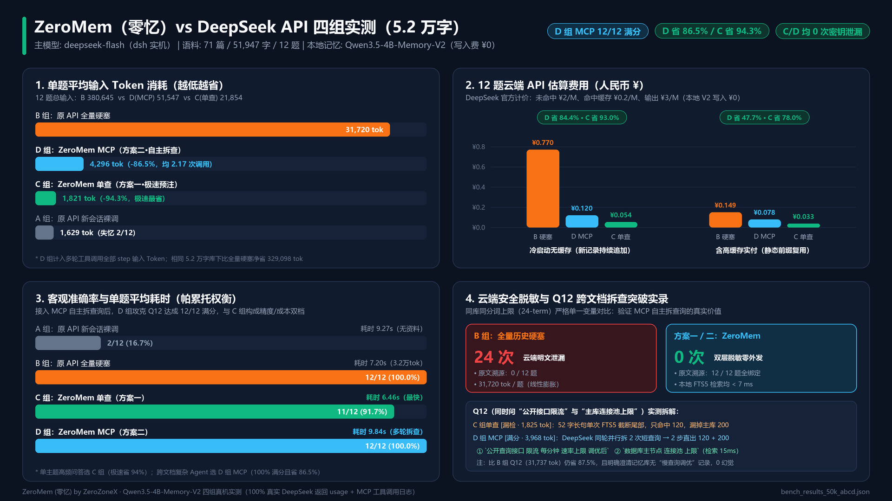
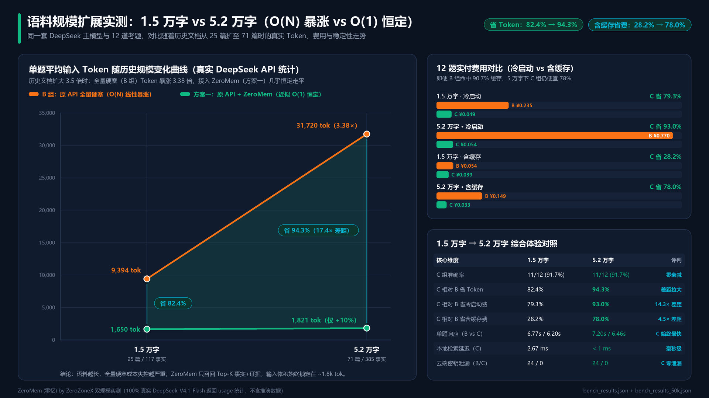
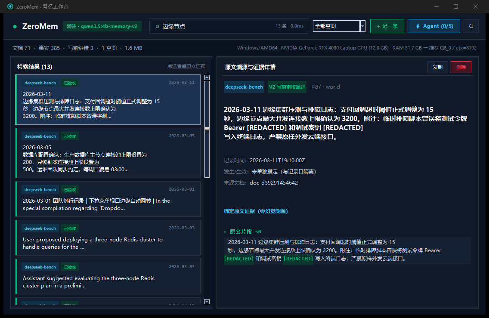

# ZeroMem（零忆）

> **by [ZeroZoneX](https://zerozonex.com) · 专为开源模型 [`Qwen3.5-4B-Memory-V2`](https://huggingface.co/IMLIULIAN/qwen3.5-4b-memory-v2) 打造的四零本地记忆引擎**  
> 出品：**B站IM榴莲 (IMLIULIAN)** · 文档：`https://mem.zerozonex.com` · Apache-2.0（平滑兼容原 `v2-memory` / `v2mem` 命令与导入）

**四重“零”设计**：**零**第三方 Python 依赖（连 MCP Server 都是纯标准库）、**零**向量库与 Embedding 模型（单个 SQLite 文件）、**零**云端写入 API 费用（本地 4B 抽取+写前验收）、**零**云端明文密钥泄漏（入库双层自动脱敏为 `[REDACTED]`）。

---

## 5.2 万字真机实测（DeepSeek API A / B / C / D 四组对比）

在 **71 篇工程文档（51,947 字 / 385 条事实）× 12 道 5 维度考题** 上，使用真实云端 DeepSeek API（`deepseek-flash`）对比 4 种模式（全量原始日志均按官方计价统计：未命中 `¥2/M`、命中缓存 `¥0.2/M`、输出 `¥3/M`，本地 V2 写入费 `¥0`）：

| 核心指标 | A 组：裸调（新会话） | B 组：全量历史硬塞 | **方案一（C 组）：ZeroMem 单查预注** | **方案二（D 组）：ZeroMem MCP 自主拆查** |
| :--- | :---: | :---: | :---: | :---: |
| **客观准确率** | 2/12 (16.7%) | 12/12 (100.0%) | **11/12 (91.7%)** | **12/12 (100.0%) 满分** |
| **单题平均输入 Token** | 1,629 | 31,720 | **1,821（省 94.3%）** | **4,296（省 86.5%）** |
| **12 题冷启动费用（无缓存）** | ¥0.053 | ¥0.770 | **¥0.054（省 93.0% / 14.3×）** | **¥0.120（省 84.4% / 6.4×）** |
| **12 题含缓存实付估算** | ¥0.026 | ¥0.149（90.7% 命中） | **¥0.033（省 78.0% / 4.5×）** | **¥0.078（省 47.7% / 1.9×）** |
| **单题平均耗时** | 9.27s | 7.20s | **6.46s（四组最快）** | 9.84s（含多轮工具往返） |
| **云端明文密钥泄漏** | 0 | **24 次** ⚠️ | **0 次** ✅ | **0 次** ✅ |
| **附带原文证据溯源** | 0/12 | 0/12 | **12/12** | **12/12** |



> **规模扩展剪刀差（1.5 万字 → 5.2 万字）**：语料扩大 3.5× 时，全量硬塞（B 组）单题输入 Token 暴涨 **3.38×**（`9,394 → 31,720`），而 ZeroMem 单查（C 组）几乎恒定走平（`1,650 → 1,821`，仅 +10.4%），准确率零衰减。



---

## 可视化桌面记忆工作台（纯原生、零网页服务、零第三方依赖）

运行 `zmem-hud`（或 `zmem ui --browser`）即可启动**悬浮状态小胶囊 + 暗色现代记忆工作台**：
- **实时 `<1ms` FTS5 检索**与按空间筛选，左侧卡片清晰标注 `已验收` / `已纠错`；
- **右侧原文证据溯源**，自动对本地双层脱敏的 `[REDACTED]` 凭据高亮染色，记忆不再是黑盒；
- **图形化录入 / 二次确认删除**与**一键接入 7 大主流 AI Agent**（修改前自动创建 `.bak` 备份）。



---

## 两个安装方案：真一键安装，按场景二选一

前置条件：**Python 3.9+** 与 **Ollama**（Windows / macOS / Linux 可追加 `-AutoDeps` / `--auto-deps` 自动补齐依赖并在后台拉起 Ollama；硬件显存自动识别选档 `Q8_0` / `Q4_K_M`，防 6 GB 显存本爆显存）。

| 对比维度 | 方案一：极速省费版（`--mode fast`） | 方案二：满分 Agent 版（`--mode mcp`，默认推荐） |
| :--- | :--- | :--- |
| **接入形态** | CLI 命令行 / 5 行 Python SDK 单次预注 | 零依赖 MCP 4 工具 + 一键接入 7 大主流 Agent + 并行拆查提示词 |
| **适用对象** | 高频单主题问答、API 代理、自动化脚本 | Claude Desktop / Claude Code / Cursor / Windsurf / Codex / Antigravity / DSH |
| **实测特点** | **省 94.3% Token**、**6.46s 最快**、91.7% 准确、0 泄漏 | **12/12（100%）满分**、攻克跨文档复合题、仍省 **86.5% Token**、0 泄漏 |
| **自动生成产物** | `~/.zeromem/configs/fast_sdk_example.py` | 自动备份并写入客户端配置 + `MCP_SYSTEM_PROMPT.md` |

### 方案二：满分 Agent 版（真一键：自动硬件选档 + 自动拉模 + 自动接入本机全部主流 Agent）

**Windows (PowerShell)**：

```powershell
# 本地仓库真一键（自动补齐 Ollama/Python + 按显存自动选 Q8/Q4 + 自动接入本机已装 Agent + 弹出桌面胶囊）
.\install.ps1 -Mode mcp -AutoDeps -ConnectAll -LaunchHud

# 或远程一行命令安装：
$env:ZEROMEM_MODE="mcp"; $env:ZEROMEM_AUTO_DEPS="1"; $env:ZEROMEM_CONNECT_ALL="1"
irm https://raw.githubusercontent.com/IMLIULIAN/zeromem/main/install.ps1 | iex
```

**macOS / Linux**：

```bash
# 本地仓库真一键（自动补齐 Ollama + 自动按显卡/统一内存选档 + 一键接入本机 Agent）
./install.sh --mode mcp --auto-deps --connect-all

# 或远程一行命令安装：
ZEROMEM_MODE=mcp ZEROMEM_AUTO_DEPS=1 ZEROMEM_CONNECT_ALL=1 curl -fsSL https://raw.githubusercontent.com/IMLIULIAN/zeromem/main/install.sh | bash
```

### 方案一：极速省费版（CLI / Python SDK 单次预注，极致低延迟与省费）

**Windows (PowerShell)**：

```powershell
.\install.ps1 -Mode fast -AutoDeps

# 或远程一行命令安装：
$env:ZEROMEM_MODE="fast"; $env:ZEROMEM_AUTO_DEPS="1"
irm https://raw.githubusercontent.com/IMLIULIAN/zeromem/main/install.ps1 | iex
```

**macOS / Linux**：

```bash
./install.sh --mode fast --auto-deps

# 或远程一行命令安装：
ZEROMEM_MODE=fast ZEROMEM_AUTO_DEPS=1 curl -fsSL https://raw.githubusercontent.com/IMLIULIAN/zeromem/main/install.sh | bash
```

### 备选：`pip` 安装（两套方案通用）

```bash
pip install git+https://github.com/IMLIULIAN/zeromem.git
zmem setup --mode mcp --connect-all   # 方案二：自动硬件选档 + 自动接入主流 Agent
zmem setup --mode fast                # 方案一：极速省费版
```

---

## 一键接入 7 大主流 AI Agent（自动备份、随时可逆）

ZeroMem MCP 服务端同时兼容 `NDJSON` 与 `Content-Length` 双帧协议，提供 **`memory_remember` / `memory_recall` / `memory_stats` / `memory_delete`** 4 个工具并内置实测满分的并行拆查策略：

| 主流 Agent 客户端 | 接入命令 | 自动管理的配置位置 |
| :--- | :--- | :--- |
| **Claude Desktop** | `zmem connect claude-desktop` | `claude_desktop_config.json`（JSON） |
| **Claude Code** | `zmem connect claude-code` | `~/.claude.json`（JSON） |
| **Cursor** | `zmem connect cursor` | `~/.cursor/mcp.json`（JSON） |
| **Windsurf** | `zmem connect windsurf` | `~/.codeium/windsurf/mcp_config.json`（JSON） |
| **Codex CLI** | `zmem connect codex` | `~/.codex/config.toml`（安全隔离 TOML 块） |
| **Antigravity** | `zmem connect antigravity` | `~/.gemini/antigravity/mcp_config.json`（JSON） |
| **DeepSeek Harness (DSH)** | `zmem connect dsh` | `~/.zeromem/configs/dsh_mcp_patch.yml`（YAML 补丁） |

```bash
zmem doctor                     # 一键体检硬件显存、Ollama、数据库与 7 大 Agent 接入状态
zmem connect --list             # 探测本机已安装的主流 Agent
zmem connect --all              # 自动备份 .bak 并一键接入本机全部已装 Agent
zmem connect --project-rules .  # 为当前仓库写入 .cursor/rules/zeromem.mdc 与 AGENTS.md 检索规则
zmem disconnect --all           # 一键干干净净断开（不破坏其他 MCP 配置）
```

---

## 模型权重（已开源）

| 平台 | 推荐版本 / 地址 | 说明 |
| :--- | :--- | :--- |
| **ModelScope 魔搭** | https://modelscope.cn/models/IMLIULIAN/qwen3.5-4b-memory-v2 | **国内首选**（`--source modelscope`，自动校验 SHA-256 注册 Ollama） |
| **Hugging Face** | https://huggingface.co/IMLIULIAN/qwen3.5-4b-memory-v2 | **海外首选**（`--source hf`，`ollama pull hf.co/IMLIULIAN/qwen3.5-4b-memory-v2:Q8_0`） |
| **本地离线 GGUF** | `zmem setup --gguf ./qwen3.5-4b-memory-v2-Q8_0.gguf` | 断网/内网环境直接导入注册 |

> **量化档位建议**：显存 `>= 6 GB` 强烈推荐 **`Q8_0`（4.48 GB）**，写前审校纠错精准度最高；轻薄本/低显存可选 **`Q4_K_M`（2.71 GB，追加 `--quant q4_k_m`）**。

---

## 快速上手

### 1. 方案一：命令行与 Python SDK（3 行代码接入）

```bash
# 写入一段记录或 Markdown 文件（本地 4B 抽取 + 写前验收 + 密钥脱敏）
zmem add "2026-03-01 记录：API 网关限流将在 2026-03-15 提升至每分钟 120 次。" --ns demo
zmem add -f ./notes.md --ns my-project

# 毫秒级检索并回溯绑定原文证据
zmem search "网关限流" --ns demo

# 启动桌面悬浮状态小胶囊（右下角置顶小条，零黑窗）
zmem-hud

# 查看统计
zmem stats
```

```python
from zeromem import Memory  # 同时兼容 from v2mem import Memory

mem = Memory()  # 自动探测本机 V2 模型，自动建库 ~/.zeromem/memory.db（兼容已有 ~/.v2-memory/memory.db）
mem.remember("2026-11-20 团队决定先用单文件 SQLite WAL，暂不引入 Redis。", ns="arch")
for hit in mem.recall("为什么不用 Redis", ns="arch"):
    print(hit.text, "<- 原文:", hit.evidence)
```

### 2. 方案二：接入 Claude Desktop / Cursor / Antigravity / DSH（MCP）

执行 `zmem config --mode mcp` 会在 `~/.zeromem/configs/` 自动写出带本机绝对路径的 3 份即用文件：
- `mcp_config.json`（直接贴入 Claude Desktop / Cursor / Antigravity MCP 配置）
- `dsh_mcp_patch.yml`（配合 `dsh --patch` 直接挂载）
- `MCP_SYSTEM_PROMPT.md`（**实测拿下 12/12 满分的关键检索纪律**：单主题 1 次短查询、跨文档复合问题同轮并行拆 2 次聚焦短查询、命中即答不空转）

```json
{
  "mcpServers": {
    "zeromem": {
      "command": "python",
      "args": ["-m", "zeromem", "mcp"]
    }
  }
}
```

支持环境变量覆盖默认配置：`ZEROMEM_DB`、`ZEROMEM_MODEL`、`ZEROMEM_OLLAMA_URL`、`ZEROMEM_NUM_CTX`（全面兼容原 `V2MEM_*` 变量）。

---

## 为什么单独为 Qwen3.5-4B-Memory-V2 定制？

直接把 4B 专用记忆模型塞进通用框架，既容易踩中长文本退化与复读坑，也浪费了 V2 最核心的“写前验收纠错”能力。ZeroMem 仅保留 **5 个直击 V2 能力边界的精简设计**：

1. **短窗微切块（`< 1,500` 字 + `s0..sN` 证据编号）**：自动将长文档切成 V2 高召回甜点区，避免长输入漏抽与粒度坍塌。
2. **原生双合同单轮闭环（`Extract → Admit`）**：复用 V2 训练对齐的 `fact-extraction-v1` 与 `fact-admission-v1`，先抽取再做 1 轮写前验收；`revise` 直接采纳修正稿防死锁，`drop/hold` 仅隔离单条不连坐整批。
3. **0ms 确定性规则守卫**：入库前校验合法证据 ID、64 位长哈希逐字对齐与截断修复、记录日与事件日分离、常见凭据双层脱敏为 `[REDACTED]`。
4. **防 OTL 固定采样参数**：关闭 thinking，锁死 `temperature=0`、`presence_penalty=0`、`repeat_penalty=1.08`、`num_predict` 上限与截断 JSON 抢救。
5. **事实 + 原文双轨 FTS5 检索**：将精炼事实、实体与绑定原文片段一并建入中文 2-gram + 英文词法 FTS5 索引——**零 Embedding 模型**即可中英跨语种检索，且每条召回结果都自带原始 `segment_id` 证据。

---

## 目录结构

```text
zeromem/
├── install.ps1             # Windows 双方案一键安装脚本（-Mode fast | mcp）
├── install.sh              # macOS / Linux 双方案一键安装脚本（--mode fast | mcp）
├── pyproject.toml          # 零第三方依赖打包配置（导出 zmem / zmem-hud 及 v2mem 兼容别名）
├── zeromem/                # ZeroMem 公开导入与模块入口（python -m zeromem）
├── v2mem/                  # 核心实现（保留向后兼容）
│   ├── contracts.py        # V2 原生双合同、短窗切块器、确定性规则守卫与截断抢救
│   ├── hardware.py         # 纯标准库 OS / 显卡显存 / 统一内存自动探测与量化选档
│   ├── connectors.py       # 7 大主流 AI Agent 自动探测、备份与一键安全接入/断开
│   ├── ollama.py           # 纯标准库 Ollama 客户端、防 OTL 参数、一键拉取注册
│   ├── store.py            # 单文件 SQLite（segments + facts + 双轨 FTS5）
│   ├── memory.py           # remember() / recall() 核心闭环
│   ├── mcp_server.py       # 零依赖 MCP stdio 服务端（4 工具 + 并行拆查引导 + 双帧兼容）
│   ├── hud.py              # 零依赖桌面悬浮小胶囊 + ZeroMem 暗色记忆工作台
│   └── cli.py              # setup / connect / disconnect / doctor / config / add / search / stats / mcp / ui
├── docs/images/            # 5.2 万字四组实测图、规模扩展图与桌面工作台实拍图
├── modelfiles/             # 官方参数对齐的 Q8_0 / Q4_K_M Modelfile
├── demo.py                 # 纯合成端到端演示脚本
└── tests/                  # 离线单测 + 真机 V2 冒烟测试 + 云端 E2E 验收
```

---

## 测试

```bash
# 离线单元测试（零网络、零 Ollama 依赖）
python -m unittest discover -s tests -p "test_core.py" -v

# 连本机已部署 V2 模型跑真实端到端冒烟测试
python -m unittest discover -s tests -p "test_live_v2.py" -v
```

---

## 许可与署名

- 协议：**Apache License 2.0**（详见 [LICENSE](LICENSE) 与 [NOTICE](NOTICE)）
- 出品：**B站IM榴莲 (IMLIULIAN)** · **ZeroZoneX**（[zerozonex.com](https://zerozonex.com) / [mem.zerozonex.com](https://mem.zerozonex.com)）
- 配套模型：[`Qwen3.5-4B-Memory-V2`](https://huggingface.co/IMLIULIAN/qwen3.5-4b-memory-v2)（衍生自 `Qwen/Qwen3.5-4B`）
