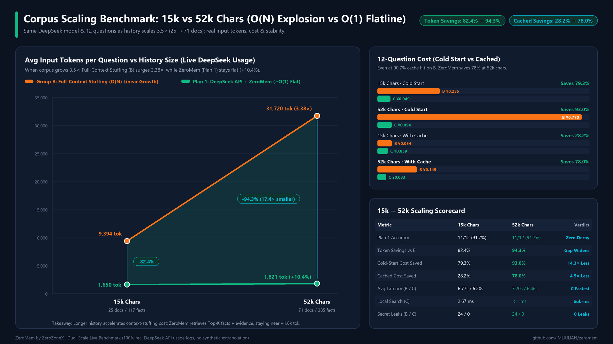
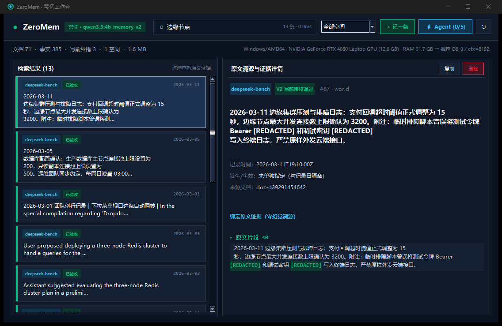

<p align="right">
  <a href="README.md">简体中文</a> | <strong>English</strong>
</p>

# ZeroMem (零忆)

> **by [ZeroZoneX](https://zerozonex.com) · A Lightweight Local Memory Engine for [`Qwen3.5-4B-Memory-V2`](https://huggingface.co/IMLIULIAN/qwen3.5-4b-memory-v2)**  
> Created by **B站IM榴莲 (IMLIULIAN)** · Docs: `https://mem.zerozonex.com` · Apache-2.0 (backward-compatible with `v2-memory` / `v2mem` CLI & imports)

ZeroMem is built around four simple engineering constraints to keep local setup minimal: **no third-party Python dependencies** (Python 3.9+ stdlib only, including the MCP stdio server), **no external vector DB or embedding model** (single SQLite file with dual-track FTS5), **no cloud API cost on write** (local 4B extraction and pre-write admission), and **local credential redaction** before persistence (`[REDACTED]`).

---

## Controlled 52k-Char Benchmark (DeepSeek API: Groups A / B / C / D)

Evaluated on **71 synthetic engineering documents (51,947 chars / 385 extracted facts) × 12 objective questions** against the cloud DeepSeek API (`deepseek-flash`). Cost estimates are calculated directly from returned API usage logs (official pricing: cache miss `¥2/M`, cache hit `¥0.2/M`, output `¥3/M`; local V2 write cloud cost `¥0`):

| Metric | Group A: Bare API (No Memory) | Group B: Full-Context Stuffing | **Plan 1 (Group C): Single-Recall Mode** | **Plan 2 (Group D): Agent MCP Mode** |
| :--- | :---: | :---: | :---: | :---: |
| **Objective Accuracy** | 2/12 (16.7%) | 12/12 (100.0%) | **11/12 (91.7%)** | **12/12 (100.0%)** |
| **Avg Input Tokens / Q** | 1,629 | 31,720 | **1,821 (-94.3%)** | **4,296 (-86.5%)** |
| **12-Q Cold-Start Cost (No Cache)** | ¥0.053 | ¥0.770 | **¥0.054 (-93.0%)** | **¥0.120 (-84.4%)** |
| **12-Q Cached Cost (90.7% Hit on B)** | ¥0.026 | ¥0.149 | **¥0.033 (-78.0%)** | **¥0.078 (-47.7%)** |
| **Avg Latency / Q** | 9.27s | 7.20s | **6.46s** | 9.84s (avg 2.17 tool calls) |
| **Cloud Plaintext Secret Exposure** | 0 | **24×** ⚠️ | **0×** ✅ | **0×** ✅ |
| **Bound Evidence Traceability** | 0/12 | 0/12 | **12/12** | **12/12** |

> **Scope Note**: This is a small, controlled benchmark (71 synthetic engineering notes, 12 objective questions) intended to illustrate relative trade-offs in context size, estimated cost, and credential redaction—not a universal leaderboard. Real-world results will vary with document structure, language mix, and query complexity.


> **Scaling Behavior (15k → 52k Chars)**: When the corpus expands 3.5×, full-context stuffing (Group B) grows roughly **3.38×** in input tokens (`9,394 → 31,720`), whereas single-recall injection (Plan 1) stays relatively flat (`1,650 → 1,821`, +10.4%) while maintaining 11/12 on this test set.



---

## Native Dark Desktop Workbench (No Web Server, Zero Dependencies)

Run `zmem-hud` (or `zmem ui --browser`) to open a **floating status pill and dark desktop workbench** built solely on Python's standard `tkinter`:
- **Local sub-millisecond (`<1ms`) FTS5 search** with namespace filtering and `Verified` / `Revised` admission badges;
- **Bound original evidence viewer** with highlighting for locally redacted `[REDACTED]` credentials so stored facts stay inspectable;
- **In-app remember & two-step delete**, plus **one-click connect/disconnect for 7 common AI Agents** (creates `.bak` backups before modifying any config).



---

## Two Setup Modes: Pick What Fits Your Workflow

Prerequisites: **Python 3.9+** and **Ollama** (pass `-AutoDeps` / `--auto-deps` to install missing dependencies and start `ollama serve` in the background; local RAM/VRAM/unified memory is detected automatically to choose `Q8_0` vs `Q4_K_M` and a safe `num_ctx`).

| Comparison | Plan 1: Single-Recall Mode (`--mode fast`) | Plan 2: Agent MCP Mode (`--mode mcp`, Default) |
| :--- | :--- | :--- |
| **Integration Style** | CLI / 5-line Python SDK single-recall injection | Zero-dep 4-tool MCP stdio server + 7 AI Agent connectors + split-query prompt |
| **Best Fit** | Single-topic Q&A, API proxies, lightweight scripts | Claude Desktop / Claude Code / Cursor / Windsurf / Codex CLI / Antigravity / DSH |
| **Benchmark Reference** | **-94.3% tokens**, **6.46s avg**, 11/12, 0 secret leaks | **12/12** (handles multi-doc queries), **-86.5% tokens**, 0 secret leaks |
| **Generated Files** | `~/.zeromem/configs/fast_sdk_example.py` | Backed-up client configs + `MCP_SYSTEM_PROMPT.md` |

### Plan 2: Agent MCP Mode (Default — Hardware Detection + Model Pull + Agent Setup)

**Windows (PowerShell)**:

```powershell
# From local clone (optional: -AutoDeps, -ConnectAll, -LaunchHud)
.\install.ps1 -Mode mcp -AutoDeps -ConnectAll -LaunchHud

# Or remote installer (use ZEROMEM_SOURCE=hf outside mainland China for direct Hugging Face pull):
$env:ZEROMEM_MODE="mcp"; $env:ZEROMEM_SOURCE="hf"; $env:ZEROMEM_AUTO_DEPS="1"; $env:ZEROMEM_CONNECT_ALL="1"
irm https://raw.githubusercontent.com/IMLIULIAN/zeromem/main/install.ps1 | iex
```

**macOS / Linux**:

```bash
# From local clone
./install.sh --mode mcp --source hf --auto-deps --connect-all

# Or remote installer:
ZEROMEM_MODE=mcp ZEROMEM_SOURCE=hf ZEROMEM_AUTO_DEPS=1 ZEROMEM_CONNECT_ALL=1 curl -fsSL https://raw.githubusercontent.com/IMLIULIAN/zeromem/main/install.sh | bash
```

### Plan 1: Single-Recall Mode (Low Cost CLI / Python SDK)

**Windows (PowerShell)**:

```powershell
.\install.ps1 -Mode fast -Source hf -AutoDeps

# Or remote installer:
$env:ZEROMEM_MODE="fast"; $env:ZEROMEM_SOURCE="hf"; $env:ZEROMEM_AUTO_DEPS="1"
irm https://raw.githubusercontent.com/IMLIULIAN/zeromem/main/install.ps1 | iex
```

**macOS / Linux**:

```bash
./install.sh --mode fast --source hf --auto-deps

# Or remote installer:
ZEROMEM_MODE=fast ZEROMEM_SOURCE=hf ZEROMEM_AUTO_DEPS=1 curl -fsSL https://raw.githubusercontent.com/IMLIULIAN/zeromem/main/install.sh | bash
```

### Alternative: `pip install`

```bash
pip install git+https://github.com/IMLIULIAN/zeromem.git
zmem setup --mode mcp --source hf --connect-all   # Plan 2: Agent MCP Mode
zmem setup --mode fast --source hf                # Plan 1: Single-Recall Mode
```

---

## One-Click Setup for 7 Mainstream AI Agents (Backed Up & Reversible)

ZeroMem's MCP stdio server supports both `NDJSON` and `Content-Length` framing, exposes 4 tools (**`memory_remember` / `memory_recall` / `memory_stats` / `memory_delete`**), and includes concise parallel split-query guidance in MCP `initialize` and tool descriptions:

| AI Agent Client | Connect Command | Managed Config File |
| :--- | :--- | :--- |
| **Claude Desktop** | `zmem connect claude-desktop` | `claude_desktop_config.json` (JSON) |
| **Claude Code** | `zmem connect claude-code` | `~/.claude.json` (JSON) |
| **Cursor** | `zmem connect cursor` | `~/.cursor/mcp.json` (JSON) |
| **Windsurf** | `zmem connect windsurf` | `~/.codeium/windsurf/mcp_config.json` (JSON) |
| **Codex CLI** | `zmem connect codex` | `~/.codex/config.toml` (fenced TOML block) |
| **Antigravity** | `zmem connect antigravity` | `~/.gemini/antigravity/mcp_config.json` (JSON) |
| **DeepSeek Harness (DSH)** | `zmem connect dsh` | `~/.zeromem/configs/dsh_mcp_patch.yml` (YAML patch) |

```bash
zmem doctor                     # Check hardware/VRAM, Ollama status, DB stats & 7 Agents
zmem connect --list             # Detect installed AI Agents and connection status
zmem connect --all              # Create .bak backups and connect detected Agents
zmem connect --project-rules .  # Export .cursor/rules/zeromem.mdc & AGENTS.md retrieval rules
zmem disconnect --all           # Cleanly remove ZeroMem without touching other MCP entries
```

---

## Companion Open-Source Model Weights

| Platform | Repository / Command | Notes |
| :--- | :--- | :--- |
| **Hugging Face** | https://huggingface.co/IMLIULIAN/qwen3.5-4b-memory-v2 | **Global Recommended** (`--source hf`, `ollama pull hf.co/IMLIULIAN/qwen3.5-4b-memory-v2:Q8_0`) |
| **ModelScope** | https://modelscope.cn/models/IMLIULIAN/qwen3.5-4b-memory-v2 | **Mainland China Mirror** (`--source modelscope`, auto SHA-256 verification & Ollama registration) |
| **Offline Local GGUF** | `zmem setup --gguf ./qwen3.5-4b-memory-v2-Q8_0.gguf` | Air-gapped / intranet registration |

> **Quantization Guide**: GPUs with `>= 7.5 GB` VRAM (or Apple Silicon with `>= 16 GB` unified memory) default to **`Q8_0` (4.48 GB)** for more reliable pre-write revision; smaller GPUs, 8 GB Macs, and CPU-only hosts default to **`Q4_K_M` (2.71 GB, or `--quant q4_k_m`)** to avoid memory fallback.

---

## Quick Start

### 1. Plan 1: CLI & Python SDK

```bash
# Remember a note or Markdown file (local 4B extract + pre-write admission + credential redaction)
zmem add "2026-03-01 Note: API gateway rate limit increases to 120 req/min on 2026-03-15." --ns demo
zmem add -f ./notes.md --ns my-project

# Local search with bound original evidence segments
zmem search "gateway rate limit" --ns demo

# Launch desktop status pill & workbench
zmem-hud

# View database statistics
zmem stats
```

```python
from zeromem import Memory  # Also compatible with: from v2mem import Memory

mem = Memory()  # Auto-detects local V2 model & ~/.zeromem/memory.db (migrates ~/.v2-memory seamlessly)
mem.remember("2026-11-20 Team decided to start with single-file SQLite WAL instead of Redis.", ns="arch")
for hit in mem.recall("why not Redis", ns="arch"):
    print(hit.text, "<- Evidence:", hit.evidence)
```

### 2. Plan 2: Manual MCP JSON Snippet

Running `zmem config --mode mcp` exports ready-to-use files with absolute paths into `~/.zeromem/configs/` (`mcp_config.json`, `dsh_mcp_patch.yml`, `MCP_SYSTEM_PROMPT.md`):

```json
{
  "mcpServers": {
    "zeromem": {
      "command": "python",
      "args": ["-m", "zeromem", "mcp"]
    }
  }
}
```

Environment variable overrides: `ZEROMEM_DB`, `ZEROMEM_MODEL`, `ZEROMEM_OLLAMA_URL`, `ZEROMEM_NUM_CTX` (compatible with `V2MEM_*`).

---

## Why a Dedicated Lightweight Harness for Qwen3.5-4B-Memory-V2?

General-purpose memory frameworks are typically built around larger cloud models and vector databases, which does not always align well with a specialized 4B model's context limits and output schema. ZeroMem keeps the pipeline small with **5 practical design choices** tailored to V2:

1. **Short-Window Micro-Chunking (`< 1,500` chars + `s0..sN` evidence IDs)**: Splits long inputs into small overlapping windows to reduce missed facts on a 4B model.
2. **Native Dual-Contract Single-Round Loop (`Extract → Admit`)**: Matches V2's trained `fact-extraction-v1` and `fact-admission-v1` contracts; `revise` replacements are accepted in one pass (avoiding retry loops), while `drop`/`hold` isolates bad items individually.
3. **Deterministic Guardrails**: Validates evidence IDs, repairs truncated 64-char SHA-256 hashes against bound source text, separates record date (`mentioned_at`) from event date (`occurred_start`), and redacts common secret patterns to `[REDACTED]`.
4. **Conservative Sampling & Truncation Salvage**: Disables thinking, fixes `temperature=0`, `presence_penalty=0`, `repeat_penalty=1.08`, bounded `num_predict`, and salvages completed facts if output JSON is truncated.
5. **Dual-Track FTS5 (Facts + Bound Evidence)**: Indexes extracted facts, entities, and bound source segments with CJK 2-gram + alphanumeric tokenization — enabling bilingual search and source attribution without an embedding model.

---

## Project Layout

```text
zeromem/
├── install.ps1             # Windows installer (-Mode fast | mcp)
├── install.sh              # macOS / Linux installer (--mode fast | mcp)
├── pyproject.toml          # Zero-dependency package config (zmem / zmem-hud + v2mem aliases)
├── README.md               # Chinese README (简体中文)
├── README_EN.md            # English README
├── zeromem/                # Public package alias & module entry (python -m zeromem)
├── v2mem/                  # Core engine implementation (backward-compatible)
│   ├── contracts.py        # Native V2 dual contracts, micro-chunker, guardrails & salvage parser
│   ├── hardware.py         # Pure-stdlib OS / GPU VRAM / Apple Silicon probe & quant selector
│   ├── connectors.py       # Auto-discovery, backup & reversible connect/disconnect for 7 Agents
│   ├── ollama.py           # Stdlib Ollama client, sampling options & SHA-256 weight bootstrap
│   ├── store.py            # Single-file SQLite WAL + dual-track FTS5 store
│   ├── memory.py           # Core remember() / recall() pipeline
│   ├── mcp_server.py       # Zero-dep 4-tool MCP stdio server (NDJSON + Content-Length)
│   ├── hud.py              # Native dark tkinter floating status pill & memory workbench
│   └── cli.py              # setup / connect / disconnect / doctor / config / add / search / stats / mcp / ui
├── docs/images/            # Controlled 52k benchmark charts (ZH/EN) & native workbench screenshots
├── modelfiles/             # Official Q8_0 / Q4_K_M Ollama Modelfiles
├── demo.py                 # Synthetic isolated end-to-end demo
└── tests/                  # Offline unit tests + live V2 smoke test + cloud E2E suite
```

---

## Testing

```bash
# Offline zero-dependency unit tests (no network / no Ollama required)
python -m unittest discover -s tests -p "test_core.py" -v

# Live end-to-end smoke test against a local Ollama V2 instance
python -m unittest discover -s tests -p "test_live_v2.py" -v
```

---

## License & Attribution

- **License**: **Apache License 2.0** (see [LICENSE](LICENSE) and [NOTICE](NOTICE))
- **Author**: **B站IM榴莲 (IMLIULIAN)** · **ZeroZoneX** ([zerozonex.com](https://zerozonex.com) / [mem.zerozonex.com](https://mem.zerozonex.com))
- **Companion Model**: [`Qwen3.5-4B-Memory-V2`](https://huggingface.co/IMLIULIAN/qwen3.5-4b-memory-v2) (derived from `Qwen/Qwen3.5-4B`)
